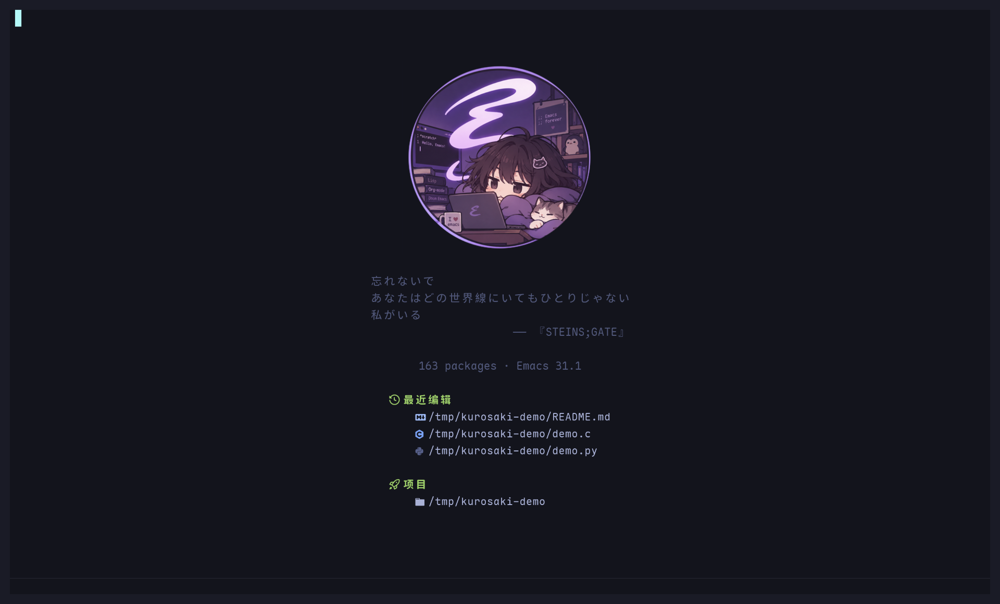
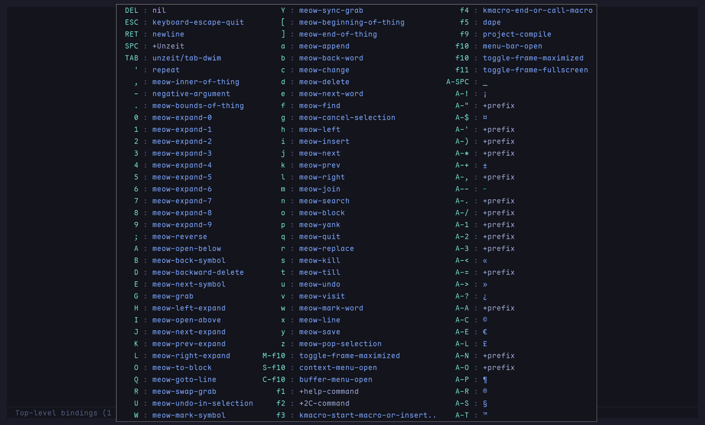

# Kurosaki-emacs

[English](README.md) | [简体中文](README.zh-CN.md)


## Table of Contents

- [Introduction](#introduction)
- [Dashboard](#dashboard)
- [Features](#features)
- [Prerequisites](#prerequisites)
- [Quick Start](#quick-start)
- [Updating](#updating)
- [Customization](#customization)
- [Keybindings](#keybindings)
- [Screenshots](#screenshots)
- [AI Declaration](#ai-declaration)
- [Acknowledgements](#acknowledgements)
- [License](#license)

## Introduction

Kurosaki-emacs is a personal Emacs distribution for Guix System and Wayland. It
is built around meow, vertico with corfu and consult, eglot with tree-sitter,
org-roam, magit, and a calm Tokyo Night interface.

It is not a generic starter kit. It is the exact configuration I use every day,
kept in one repository so it can be cloned on any machine without pulling the
whole Guix home-manager setup.

The internal namespace is still `unzeit/` for historical reasons; the project
name is Kurosaki-emacs.

## Dashboard



The dashboard shows the recent files, projects, a random quote and the leader
key hints. Which-key, vertico and transient popups use centered child frames.

## Features

- Modal editing with meow: `SPC` is the leader in normal and motion state; `C-c`
  remains a stateless prefix for the same commands.
- Modern completion: vertico, orderless, marginalia, consult and embark, plus
  corfu, cape and yasnippet, centered child-frame popups, consult extensions and
  wgrep, link-hint and browse-kill-ring helpers.
- LSP and tree-sitter: eglot, tree-sitter and apheleia for completion, diagnostics
  and formatting; a missing server only degrades, it does not error.
- Multi-language support: C/C++, Go, Python, Rust, Java, JavaScript and
  TypeScript, Web and JSP, Zig, Haskell, C3, Odin, Ruby, Lua, Dart, Julia, PHP,
  Scala, Swift, PowerShell, CMake, CSV, Fish, Protobuf, SCSS, RON and Markdown.
- File management: treemacs on `SPC f t/T`; the existing dirvish-side on
  `SPC f v/V`; dired and dirvish helpers.
- Git: magit, magit-todos, git-timemachine, browse-at-remote, git-messenger and
  git-modes; `SPC g` is the git prefix.
- Notes: org, org-roam and org-roam-ui; the roam database uses the SQLite built
  into Emacs 31, so no external sqlite3 is required.
- Polished UI: Tokyo Night theme, Maple Mono NF CN, dashboard, centered
  which-key, transient and vertico child frames, ultra-scroll, solaire-mode,
  eol diagnostic chips and an eldoc-mouse point-dwell popup.
- Guix integration: emacs-guix, guix-devel-mode, build-log highlighting and
  store-path prettifying.
- Chinese-first: Chinese font sets, pinyin-aware search and CJK spacing.

## Prerequisites

### Operating system

- Guix System is the primary target. The home module lives in
  `home/editor/editor.scm` and `home/lang/lang.scm`.
- Linux and Wayland is the tested display setup (niri and Noctalia).
- For the standalone setup, any Emacs 31.1 build with pgtk works. pgtk is
  required for native Wayland clipboard and child-frame behaviour.

### GNU Emacs

GNU Emacs 31.1 or newer is required. The configuration relies on:

- native tree-sitter (treesit)
- native JSON and SQLite
- pgtk for Wayland
- libgccjit for native compilation, optional but recommended

### Fonts

- Maple Mono NF CN for the body, CJK and Nerd icons
- LXGW WenKai Mono for org writing
- Noto Color Emoji for emoji

### External tools

The configuration degrades gracefully when these are absent, but the full
experience needs:

- language servers: clangd, gopls, rust-analyzer, zls, hls, solargraph,
  lua-language-server, typescript-language-server, vscode-html-language-server
  and vscode-css-language-server
- formatters: clang-format, gofmt or gofumpt, rustfmt, zig fmt and prettier
- tree-sitter grammars from the Guix profile

## Quick Start

### Guix Home

The configuration is consumed as a git submodule by the Guix home repository:

```sh
git clone ssh://git@codeberg.org/Lofi_Concrete/lc-guix-home-manager.git ~/guix
git -C ~/guix submodule update --init --recursive
guix home reconfigure ~/guix/home/home.scm \
  --load-path="$HOME/Projects/lc-guix-channels/guix" --fallback
```

The `--load-path` is required because the home config imports packages from the
lc-guix channel. The submodule lives at `home/editor/.emacs.d`.

### Standalone

To use the Emacs configuration without the Guix home layer:

```sh
mv ~/.emacs.d ~/.emacs.d.bak
git clone <Kurosaki-emacs-url> ~/.emacs.d
~/.emacs.d/tests/preinstall-modern.sh
~/.emacs.d/tests/preinstall-features.sh
cp ~/.emacs.d/lisp/init-local.example.el ~/.emacs.d/lisp/init-local.el
```

Then install the fonts and the external tools listed above. Start Emacs; the
first startup probes the ELPA mirrors and installs anything still missing.

### First startup

- The package mirror is probed in the background; no network request is made on
  the critical startup path.
- `M-x unzeit/doctor` prints a health report: fonts, language servers,
  tree-sitter grammars, package state and the active configuration.
- If the configuration looks stale, remember that `~/.emacs.d` is deployed from
  the store in the Guix setup. Edit the repository, run
  `guix home reconfigure`, then restart Emacs.

## Updating

Standalone:

```sh
git -C ~/.emacs.d pull --ff-only
emacs --batch -Q --eval '(progn (package-initialize) (package-quickstart-refresh))'
```

Guix home:

```sh
git -C ~/guix submodule update --remote --merge
guix home reconfigure ~/guix/home/home.scm \
  --load-path="$HOME/Projects/lc-guix-channels/guix" --fallback
```

Restart Emacs after the reconfigure; the running instance keeps its old store.

## Customization

- `unzeit/modern-*`: toggles for the modern layer (scroll, GC, posframe,
  vertico-posframe, solaire and diagnostics). Run
  `M-x customize-group unzeit/modern`.
- `init-local.el`: machine-local overrides that Guix never deploys. Copy
  `lisp/init-local.example.el` and edit it.
- Fonts: `unzeit/body-font-height` and `unzeit/ui-font-height` in `lisp/core.el`;
  the frame font string in `early-init.el`.
- Languages: every language lives in its own file under `langs/`; a new `.el`
  file is loaded automatically.
- Theme: a single fixed Tokyo Night palette in `lisp/unzeit-theme.el`.

## Keybindings

`SPC` is the leader in meow normal and motion state; `C-c` exposes the same
custom commands without a state prefix.

| Key | Action |
|-----|--------|
| `SPC f t` / `SPC f T` | treemacs toggle / focus |
| `SPC f v` / `SPC f V` | dirvish-side toggle / focus |
| `SPC f f` / `SPC f s` / `SPC f o` | find file / save / other window |
| `SPC f e` | consult-dir |
| `SPC s s` / `SPC s g` | consult-line / consult-ripgrep |
| `SPC s y` / `SPC s T` / `SPC s F` | consult-yasnippet / todo / flyspell |
| `SPC g s` / `SPC g l` / `SPC g d` | magit status / log / diff |
| `SPC g T` / `SPC g t` / `SPC g o` / `SPC g m` | magit-todos / timemachine / browse-at-remote / git-messenger |
| `SPC o r` / `SPC o i` / `SPC o b` | org-roam node-find / insert / buffer-toggle |
| `SPC o d` / `SPC o u` | org-roam dailies / org-roam-ui |
| `SPC o a` / `SPC o c` | org-agenda / org-capture |
| `SPC l d` / `SPC l r` / `SPC l o` | xref definition / references / link-hint |
| `SPC y` | browse-kill-ring |
| `SPC c g` | Guix packages / generations / services |
| `SPC ?` | help commands |
| `C-c t` / `C-c v` | treemacs / dirvish-side |
| `C-c a` / `C-c c` | org-agenda / org-capture |
| `C-c g` | Guix popup |

## Screenshots

Which-key popup:



The dashboard screenshot at the top of this README shows the same setup.

## AI Declaration

This project is AI-assisted. Parts of the Emacs Lisp modules, language files,
documentation and this README were generated or edited with the help of AI
coding agents (DeepSeek Harness, powered by DeepSeek models). The human
maintainer reviews, tests and remains responsible for the configuration.
AI-generated content can be incomplete or wrong; use it at your own risk.

See [AI-DECLARATION.md](AI-DECLARATION.md) for the full statement.

## Acknowledgements

- Centaur Emacs (https://github.com/seagle0128/.emacs.d): the README layout and
  several UI ideas are inspired by it.
- The Emacs, Guix, meow, vertico, corfu, consult, embark, eglot, magit and
  org-roam communities.
- Maple Mono, LXGW WenKai and the Tokyo Night theme.

## License

GPL-3.0. See [LICENSE](LICENSE) or https://www.gnu.org/licenses/gpl-3.0.
